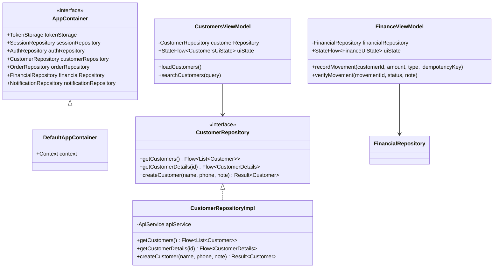
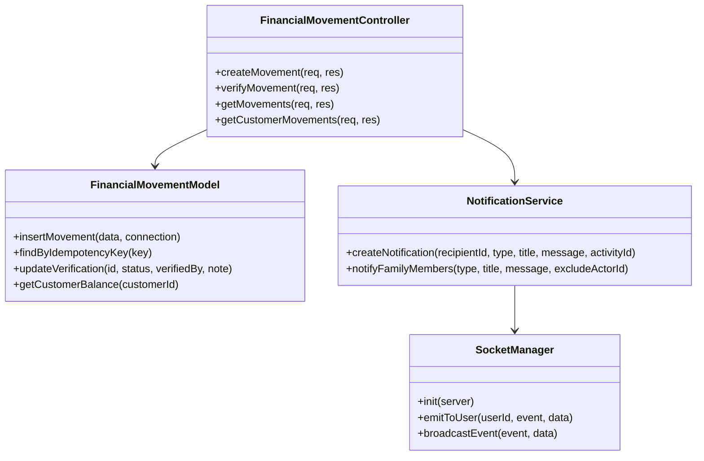
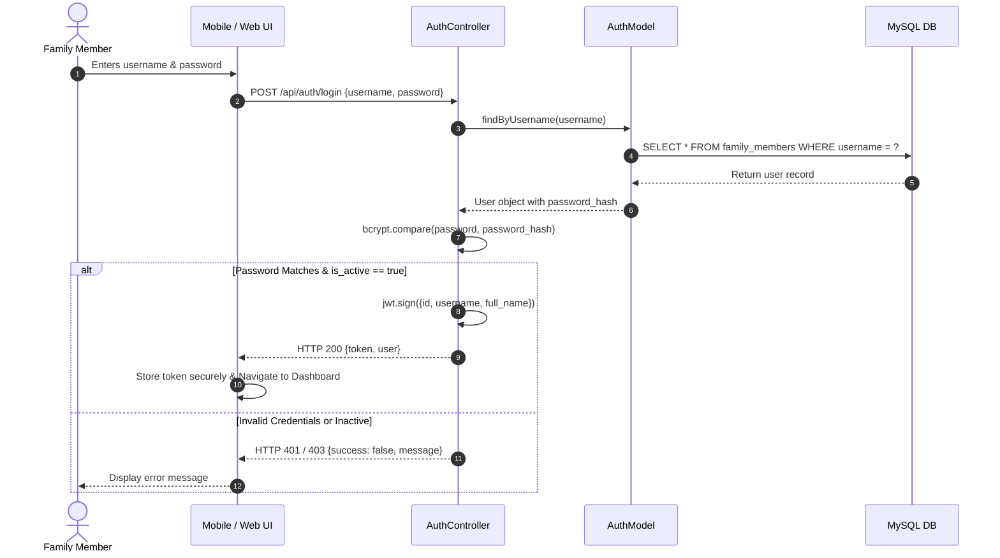
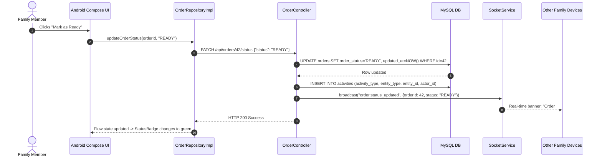

# Chule Digital Design Document
**v.1.0**  
**Course / Discipline:** Software Engineering / Enterprise Systems  
**Authors:** Addisu Hirbo & Chule Digital Engineering Team  
**Group:** 1  

---

## Document Revision History

| Date | Version | Description | Author |
| :--- | :--- | :--- | :--- |
| 2026-10-16 | 0.0 | Initial design draft and entity modeling | Addisu Hirbo |
| 2026-10-20 | 0.5 | Added Android Clean Architecture & Web Component designs | Chule Team |
| 2026-10-23 | 1.0 | Complete architectural, structural, and dynamic model specification | Addisu Hirbo |

---

## Contents
- [1 Introduction](#1-introduction)
  - [1.1 Purpose](#11-purpose)
  - [1.2 System Overview](#12-system-overview)
  - [1.3 Design Objectives](#13-design-objectives)
  - [1.4 References](#14-references)
  - [1.5 Definitions, Acronyms, and Abbreviations](#15-definitions-acronyms-and-abbreviations)
- [2 Design Overview](#2-design-overview)
  - [2.1 Introduction](#21-introduction)
  - [2.2 Environment Overview](#22-environment-overview)
  - [2.3 System Architecture](#23-system-architecture)
    - [2.3.1 Top-Level Multi-Tier Architecture](#231-top-level-multi-tier-architecture)
    - [2.3.2 Backend Layered Subsystem](#232-backend-layered-subsystem)
    - [2.3.3 Android Clean Architecture Subsystem](#233-android-clean-architecture-subsystem)
    - [2.3.4 Web React Client Subsystem](#234-web-react-client-subsystem)
  - [2.4 Constraints and Assumptions](#24-constraints-and-assumptions)
- [3 Interfaces and Data Stores](#3-interfaces-and-data-stores)
  - [3.1 System Interfaces](#31-system-interfaces)
    - [3.1.1 RESTful JSON API Interface](#311-restful-json-api-interface)
    - [3.1.2 Real-Time WebSocket Interface](#312-real-time-websocket-interface)
    - [3.1.3 Mobile Retrofit/OkHttp Client Interface](#313-mobile-retrofitokhttp-client-interface)
    - [3.1.4 Web Axios Interface](#314-web-axios-interface)
  - [3.2 Data Stores](#32-data-stores)
- [4 Structural Design](#4-structural-design)
  - [4.1 Design Explanation and Rationale](#41-design-explanation-and-rationale)
  - [4.2 Class Diagrams](#42-class-diagrams)
    - [4.2.1 Android Mobile Class Diagram](#421-android-mobile-class-diagram)
    - [4.2.2 Backend Architectural Model](#422-backend-architectural-model)
  - [4.3 Class Descriptions](#43-class-descriptions)
    - [4.3.1 Subsystem: Financial Movements](#431-subsystem-financial-movements)
    - [4.3.2 Subsystem: Order Management](#432-subsystem-order-management)
    - [4.3.3 Subsystem: Android Customer Repository](#433-subsystem-android-customer-repository)
    - [4.3.4 Subsystem: Real-Time Notification & Socket Manager](#434-subsystem-real-time-notification--socket-manager)
- [5 Dynamic Model](#5-dynamic-model)
  - [5.1 Scenarios](#51-scenarios)
    - [5.1.1 Scenario 1: Authentication & Token Provisioning](#511-scenario-1-authentication--token-provisioning)
    - [5.1.2 Scenario 2: Idempotent Financial Movement Recording & Supervisor Verification](#512-scenario-2-idempotent-financial-movement-recording--supervisor-verification)
    - [5.1.3 Scenario 3: Real-Time Order Status Transition & Notification Broadcast](#513-scenario-3-real-time-order-status-transition--notification-broadcast)
- [6 Supplementary Documentation](#6-supplementary-documentation)

---

## 1 Introduction

### 1.1 Purpose
The purpose of this Software Design Document (SDD) is to describe the complete software architecture, technical components, subsystem interfaces, structural designs, and dynamic behaviors of **Chule Digital (Family Business Management System)**. It serves as the definitive technical blueprint allowing any software engineering team to understand, maintain, test, and extend the system.

### 1.2 System Overview
Chule Digital is a comprehensive enterprise management solution built specifically for family-operated businesses. It bridges the gap between fast-paced mobile shop transactions and structured desktop financial oversight. The system provides:
- Centralized customer profiles with complete transaction and credit history.
- Two-step verification workflows for financial movements and customer notes.
- Strict protection against duplicate entries using database-backed idempotency.
- Event-driven real-time notifications across web and mobile platforms.
- An immutable audit trail guaranteeing accountability across family members.

### 1.3 Design Objectives
The design of Chule Digital addresses the following key objectives:
1. **Decoupling and Separation of Concerns:** Rigid separation between presentation, application business logic, and persistent storage layers.
2. **Auditability and Dual Control:** Every financial action is associated with an authenticated actor, and significant credit/debit movements require multi-user verification.
3. **Robustness and Idempotency:** Elimination of double-charges and race conditions caused by network retries on mobile devices.
4. **Real-Time Responsiveness:** Sub-second dispatch of business events using WebSockets without excessive HTTP polling.
5. **High Maintainability:** Application of standard design patterns including Repository Pattern, Dependency Injection (via `AppContainer`), Layered Architecture, and Unidirectional Data Flow (StateFlow / React Context).

### 1.4 References
- Chule Digital Software Requirements Specification (SRS) v1.0.
- IEEE Std 1016-2009: *Standard for Information Technology — Systems Design — Software Design Descriptions*.
- Gamma et al., *Design Patterns: Elements of Reusable Object-Oriented Software* (Addison-Wesley, 1994).
- Martin, Robert C., *Clean Architecture: A Craftsman’s Guide to Software Structure and Design* (Prentice Hall, 2017).

### 1.5 Definitions, Acronyms, and Abbreviations
- **API:** Application Programming Interface.
- **DAO:** Data Access Object / Model Layer.
- **DTO:** Data Transfer Object.
- **DI:** Dependency Injection.
- **Idempotency Key:** A unique UUID generated by the client to uniquely identify an intended financial operation.
- **JWT:** JSON Web Token.
- **MVVM:** Model-View-ViewModel architectural pattern.
- **UDF:** Unidirectional Data Flow.

---

## 2 Design Overview

### 2.1 Introduction
The design adopts a hybrid architecture:
- **Backend:** Layered Architecture / Service-Oriented Micro-Monolith built on Node.js and Express. It follows the **Controller-Service-Model** pattern.
- **Android Mobile:** **Clean Architecture** combined with **MVVM** and **Unidirectional Data Flow (UDF)** using Kotlin Coroutines and StateFlow.
- **Web Frontend:** Component-based SPA architecture using React 19, Vite, and Context API.
- **Database:** Fully normalized 3NF relational schema in MySQL 8.0 with InnoDB transactional engine.

### 2.2 Environment Overview
The system operates in a distributed network topology:

```
[Android Mobile Client]  (Kotlin Jetpack Compose, Min SDK 24, Target SDK 35)
          |
          | HTTPS REST + WSS (Socket.IO)
          v
[Cloud / Local Server]   (Node.js v20 LTS, Express 5, Port 5000 / Reverse Proxy)
          |
          | Connection Pool (mysql2, Port 3306)
          v
[MySQL 8.0 Database]     (InnoDB, utf8mb4_unicode_ci, ACID Transactions)
          ^
          | HTTPS REST + WSS (Socket.IO)
          |
[React Web Client]       (Vite SPA, Modern Web Browsers)
```

The application server can reside on a local on-premise business server (for local LAN reliability) or cloud VM (AWS EC2 / DigitalOcean Droplet / Render) fronted by an Nginx reverse proxy providing SSL/TLS termination.

### 2.3 System Architecture

#### 2.3.1 Top-Level Multi-Tier Architecture
The top-level architecture is organized into three distinct tiers:
1. **Client Tier:** Android Mobile App and React Web App.
2. **Application Server Tier:** Node.js / Express backend hosting REST API routes, controllers, business services, security middleware, and WebSocket engine.
3. **Data Persistence Tier:** MySQL 8.0 relational database holding ACID-compliant relational tables.

#### 2.3.2 Backend Layered Subsystem
```
+--------------------------------------------------------------+
|                     HTTP / WebSocket Requests                |
+--------------------------------------------------------------+
                               |
                               v
+--------------------------------------------------------------+
| Middleware: Helmet, CORS, Compression, AuthMiddleware (JWT)  |
+--------------------------------------------------------------+
                               |
                               v
+--------------------------------------------------------------+
| Controllers: Request Validation, DTO Parsing, Response Output |
+--------------------------------------------------------------+
                               |
                               v
+--------------------------------------------------------------+
| Services: Business Rules, Idempotency Checks, Verification   |
+--------------------------------------------------------------+
                               |
                               v
+--------------------------------------------------------------+
| Models: Parametrized SQL Queries, Connection Pool Execution  |
+--------------------------------------------------------------+
                               |
                               v
+--------------------------------------------------------------+
|              MySQL Relational Database Tables                |
+--------------------------------------------------------------+
```

#### 2.3.3 Android Clean Architecture Subsystem
The mobile app is partitioned into three concentric layers:
1. **UI Layer (`ui`):** Jetpack Compose screens (`FinanceScreen`, `OrdersScreen`, `CustomerDetailsScreen`) observing state from `ViewModel` classes via `StateFlow`.
2. **Domain Layer (`domain`):** Domain repository interfaces (`CustomerRepository`, `FinancialRepository`, `OrderRepository`) and immutable business models (`BusinessModels.kt`).
3. **Data Layer (`data`):** Concrete repository implementations (`CustomerRepositoryImpl`), network clients (`ApiService` via Retrofit), local token persistence (`TokenStorage` via DataStore), and WebSocket sync (`SocketManager`).

Dependency Injection is managed explicitly using a central `AppContainer` service locator (`DefaultAppContainer.kt`) instantiated in the custom `ChuleApplication` lifecycle.

#### 2.3.4 Web React Client Subsystem
The web portal utilizes React 19 SPA architecture:
- **Routing:** `react-router-dom` managing protected routes behind an authentication guard.
- **State Management:** React Context (`AuthContext`) for session state and custom hooks (`useSocket`) for listening to WebSocket events.
- **Layouts:** `SidebarLayout` encapsulating navigation, active user status, and dynamic alert toasts.

### 2.4 Constraints and Assumptions
1. **Idempotency Guarantee:** Financial endpoints require client-supplied UUIDs stored in a `UNIQUE` database column. This prevents duplicate charges during mobile network timeouts.
2. **Audit Immutability:** Records in `activities` and `financial_movements` are protected against arbitrary deletion via database foreign key restrictions (`ON DELETE RESTRICT`).
3. **Concurrency:** MySQL InnoDB utilizes row-level locking during transactional balance updates to prevent race conditions during simultaneous ledger entries.

---

## 3 Interfaces and Data Stores

### 3.1 System Interfaces

#### 3.1.1 RESTful JSON API Interface
All data interactions occur over standard HTTP methods:
- `POST /api/auth/login`: Authenticates family members; returns JWT and user claims.
- `GET /api/customers`: Retrieves customer list with embedded balance summary.
- `POST /api/customers`: Creates a customer profile and initial optional note.
- `GET /api/orders`: Retrieves orders; supports filtering by status and customer.
- `POST /api/orders`: Creates a new order; generates a unique `order_number`.
- `PATCH /api/orders/:id/status`: Transitions order state (`DRAFT` $\rightarrow$ `PENDING` $\rightarrow$ `COMPLETED`).
- `POST /api/financial-movements`: Records debit or credit transaction with idempotency verification.
- `PATCH /api/financial-movements/:id/verify`: Supervisor endpoint to verify or reject a movement.
- `GET /api/dashboard/stats`: Returns aggregated executive metrics.

#### 3.1.2 Real-Time WebSocket Interface
- **Protocol:** Socket.IO v4 over WebSocket / HTTP long-polling fallback.
- **Events Dispatched:**
  - `notification:new`: Dispatched when any verifiable activity or status change occurs.
  - `notification:read`: Dispatched when an operator marks an alert as read.
  - `order:status_updated`: Dispatched when an order transitions state.

#### 3.1.3 Mobile Retrofit/OkHttp Client Interface
- `ApiService.kt`: Declarative Kotlin interface decorated with `@GET`, `@POST`, `@PATCH`.
- `AuthInterceptor.kt`: OkHttp interceptor reading JWT token from `SessionRepository` and appending `Authorization: Bearer <token>` to all outbound requests.
- `RetrofitClient.kt`: Configures JSON parsing using `GsonConverterFactory` and connects logging interceptors.

#### 3.1.4 Web Axios Interface
- Configured Axios instance with an interceptor that intercepts 401 Unauthorized responses to trigger automatic redirection to `/login`.

### 3.2 Data Stores
The system incorporates an internal MySQL 8.0 relational database (`chule_digita_db`). The persistent data stores include:

1. **`family_members`**:
   - `id` (BIGINT UNSIGNED, PK, AUTO_INCREMENT)
   - `full_name` (VARCHAR 150, NOT NULL)
   - `phone` (VARCHAR 30, NULL)
   - `username` (VARCHAR 100, UNIQUE, NOT NULL)
   - `password_hash` (VARCHAR 255, NOT NULL)
   - `is_active` (BOOLEAN, DEFAULT TRUE)
   - `created_at`, `updated_at` (TIMESTAMP)

2. **`customers`**:
   - `id` (BIGINT UNSIGNED, PK, AUTO_INCREMENT)
   - `full_name` (VARCHAR 150, NOT NULL, INDEXED)
   - `phone` (VARCHAR 30, NULL, INDEXED)
   - `created_by` (BIGINT UNSIGNED, FK $\rightarrow$ `family_members.id`)

3. **`customer_notes`**:
   - `id` (BIGINT UNSIGNED, PK, AUTO_INCREMENT)
   - `customer_id` (BIGINT UNSIGNED, FK $\rightarrow$ `customers.id`, ON DELETE CASCADE)
   - `note_text` (TEXT, NOT NULL)
   - `created_by` (BIGINT UNSIGNED, FK $\rightarrow$ `family_members.id`)
   - `verification_status` (ENUM: `NOT_REQUIRED`, `PENDING`, `VERIFIED`, `REJECTED`)
   - `verified_by` (BIGINT UNSIGNED, FK $\rightarrow$ `family_members.id`, NULL)
   - `verified_at` (TIMESTAMP, NULL)

4. **`orders`**:
   - `id` (BIGINT UNSIGNED, PK, AUTO_INCREMENT)
   - `customer_id` (BIGINT UNSIGNED, FK $\rightarrow$ `customers.id`, NULL ON DELETE SET NULL)
   - `order_number` (VARCHAR 50, UNIQUE, NOT NULL)
   - `title` (VARCHAR 150, NULL)
   - `description` (TEXT, NULL)
   - `order_status` (ENUM: `DRAFT`, `PENDING`, `CONFIRMED`, `PROCESSING`, `READY`, `COMPLETED`, `CANCELLED`)
   - `taken_by` (BIGINT UNSIGNED, FK $\rightarrow$ `family_members.id`)
   - `verification_status` (ENUM: `NOT_REQUIRED`, `PENDING`, `VERIFIED`, `REJECTED`)

5. **`financial_movements`**:
   - `id` (BIGINT UNSIGNED, PK, AUTO_INCREMENT)
   - `customer_id` (BIGINT UNSIGNED, FK $\rightarrow$ `customers.id`)
   - `amount` (DECIMAL 15,2, NOT NULL)
   - `movement_type` (ENUM: `DEBIT`, `CREDIT`)
   - `idempotency_key` (VARCHAR 100, UNIQUE, NULL)
   - `recorded_by` (BIGINT UNSIGNED, FK $\rightarrow$ `family_members.id`)
   - `verification_status` (ENUM: `PENDING`, `VERIFIED`, `REJECTED`)
   - `verified_by` (BIGINT UNSIGNED, FK $\rightarrow$ `family_members.id`, NULL)
   - `transaction_at` (DATETIME, NOT NULL)

6. **`activities` (Audit Trail)**:
   - `id` (BIGINT UNSIGNED, PK, AUTO_INCREMENT)
   - `actor_id` (BIGINT UNSIGNED, FK $\rightarrow$ `family_members.id`)
   - `activity_type` (VARCHAR 100, NOT NULL)
   - `entity_type` (VARCHAR 50, NOT NULL)
   - `entity_id` (BIGINT UNSIGNED, NOT NULL)
   - `metadata` (JSON, NULL)
   - `created_at` (TIMESTAMP)

7. **`notifications`**:
   - `id` (BIGINT UNSIGNED, PK, AUTO_INCREMENT)
   - `recipient_id` (BIGINT UNSIGNED, FK $\rightarrow$ `family_members.id`)
   - `activity_id` (BIGINT UNSIGNED, FK $\rightarrow$ `activities.id`, NULL)
   - `notification_type` (VARCHAR 100, NOT NULL)
   - `title` (VARCHAR 255, NOT NULL)
   - `message` (TEXT, NOT NULL)
   - `is_read` (BOOLEAN, DEFAULT FALSE)

---

## 4 Structural Design

### 4.1 Design Explanation and Rationale
The architecture strictly enforces loose coupling:
1. **Controllers** validate input syntax and extract authenticated identity (`req.user.id`).
2. **Services** execute domain logic, verify permissions, create audit records, and emit events.
3. **Models** execute prepared SQL statements via connection pool transactions.
4. **Android MVVM + Repositories** ensures UI components only react to observable `StateFlow` data streams without knowing whether data originated from local storage, memory, or network.

### 4.2 Class Diagrams

#### 4.2.1 Android Mobile Class Diagram


#### 4.2.2 Backend Architectural Model


### 4.3 Class Descriptions

#### 4.3.1 Subsystem: Financial Movements
##### 4.3.1.1 Class: `FinancialMovementController`
- **Purpose:** Handles HTTP endpoints for monetary transactions and verification reviews.
- **Constraints:** Must enforce Bearer token authentication on all methods.
- **Methods:**
  - `createMovement(req, res)`:
    - *Parameters:* `req.body` containing `customerId`, `amount`, `movementType`, `description`, `idempotencyKey`.
    - *Return:* HTTP 201 Created on success, HTTP 409 Conflict if idempotency duplicate detected.
    - *Pre-condition:* Authenticated user, positive numerical amount.
    - *Post-condition:* New movement row inserted with status `PENDING`, notification dispatched.
  - `verifyMovement(req, res)`:
    - *Parameters:* `req.params.id`, `req.body.status` (`VERIFIED` or `REJECTED`), `req.body.note`.
    - *Return:* HTTP 200 OK with updated movement record.
    - *Processing Logic:* Verifies reviewer is not the same user who recorded the movement (enforcing Dual Control). Updates status and recalculates ledger balance.

#### 4.3.2 Subsystem: Order Management
##### 4.3.2.1 Class: `OrderController`
- **Purpose:** Manages creation, retrieval, and status advancement of customer orders.
- **Methods:**
  - `createOrder(req, res)`:
    - *Processing Logic:* Generates standardized order number string `ORD-${Date.now()}-${randomSuffix}`, assigns creator as `taken_by`, persists to DB, logs audit activity.
  - `updateOrderStatus(req, res)`:
    - *Pre-condition:* Order must exist and target status must be a valid progression step in the ENUM.
    - *Post-condition:* Status updated, `order:status_updated` emitted over WebSockets.

#### 4.3.3 Subsystem: Android Customer Repository
##### 4.3.3.1 Class: `CustomerRepositoryImpl`
- **Purpose:** Concrete repository bridging Retrofit network calls with Kotlin Coroutine flows for customer data.
- **Attributes:**
  - `apiService: ApiService`: Retrofit API interface.
- **Methods:**
  - `getCustomers(): Flow<Resource<List<Customer>>>`:
    - *Parameters:* None.
    - *Return Value:* Continuous Flow of Resource wrapper (`Loading`, `Success`, `Error`).
    - *Processing Logic:* Emits `Loading`, executes asynchronous network call via `apiService.getCustomers()`, emits `Success` with mapped domain models, catches `IOException`/`HttpException` and emits `Error`.

#### 4.3.4 Subsystem: Real-Time Notification & Socket Manager
##### 4.3.4.1 Class: `SocketManager`
- **Purpose:** Manages WebSocket connections, room assignments, and event emissions.
- **Attributes:**
  - `io: Server`: Socket.IO server instance.
  - `connectedUsers: Map<Long, String>`: Map of `familyMemberId` to active socket connection ID.
- **Methods:**
  - `registerUser(userId, socketId)`: Associates authenticated user ID with their socket session.
  - `broadcastToFamily(event, payload)`: Sends real-time event to all connected family members simultaneously.

---

## 5 Dynamic Model

### 5.1 Scenarios

#### 5.1.1 Scenario 1: Authentication & Token Provisioning
A family member launches the application and authenticates with credentials.



#### 5.1.2 Scenario 2: Idempotent Financial Movement Recording & Supervisor Verification
A mobile operator logs a cash payment from a customer. A network stutter occurs, triggering an automatic client retry. Later, a supervisor verifies the transaction.

```mermaid
sequenceDiagram
    autonumber
    actor Operator as Store Operator
    actor Supervisor as Family Admin
    participant App as Mobile App
    participant FinCtrl as FinancialMovementController
    participant DB as MySQL DB
    participant Socket as SocketManager
    participant Web as Web Dashboard

    Operator->>App: Submits Credit Movement (500 ETB, UUID-1234)
    App->>FinCtrl: POST /api/financial-movements (idempotencyKey="UUID-1234")
    FinCtrl->>DB: Check idempotency_key = "UUID-1234"
    DB-->>FinCtrl: Null (first time)
    FinCtrl->>DB: INSERT INTO financial_movements (status='PENDING', amount=500, ...)
    DB-->>FinCtrl: Success (Inserted ID 88)
    FinCtrl->>Socket: broadcast("notification:new", "New payment pending verification")
    Socket-->>Web: Real-time alert badge increments
    FinCtrl-->>App: HTTP 201 Created {movementId: 88, status: 'PENDING'}

    Note over Operator,App: Network drops ACK; App retries same request
    App->>FinCtrl: POST /api/financial-movements (idempotencyKey="UUID-1234")
    FinCtrl->>DB: Check idempotency_key = "UUID-1234"
    DB-->>FinCtrl: Record Found (ID 88)
    FinCtrl-->>App: HTTP 200/409 (Returns existing record without duplicate insert)

    Supervisor->>Web: Opens Finance Screen & Clicks "Verify"
    Web->>FinCtrl: PATCH /api/financial-movements/88/verify {status: 'VERIFIED'}
    FinCtrl->>DB: UPDATE financial_movements SET status='VERIFIED', verified_by=Sup_ID
    DB-->>FinCtrl: Updated
    FinCtrl->>Socket: broadcast("notification:new", "Payment #88 Verified")
    Socket-->>App: Push notification received on mobile
    FinCtrl-->>Web: HTTP 200 Verified
```

#### 5.1.3 Scenario 3: Real-Time Order Status Transition & Notification Broadcast
A shop operator marks a customer order as `PROCESSING` and then `READY`.



---

## 6 Supplementary Documentation
- **Configuration Environment:** Backend settings are governed by environment variables loaded through `dotenv` (`PORT`, `DB_HOST`, `DB_USER`, `DB_PASSWORD`, `DB_NAME`, `JWT_SECRET`).
- **Database Backup Plan:** Scheduled daily automated mysqldump script:
  ```bash
  mysqldump -u root -p chule_digita_db > /backup/chule_digita_$(date +\%F).sql
  ```
- **Diagnostic Logging:** Real-time request logger integrated in Express automatically masks passwords and bearer tokens while recording request durations and client IPs.
